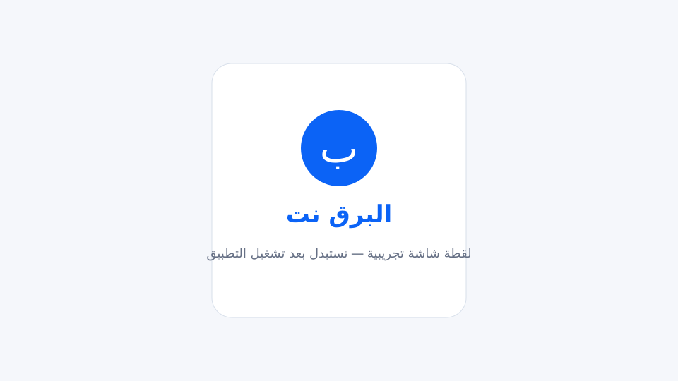

# البرق نت | ALBARQ NET

تطبيق Android لمحفظة رصيد مغلقة مخصّصة لشراء بطاقات الإنترنت من شبكة مزوّد الخدمة. لا يدعم التحويل بين المستخدمين أو السحب النقدي. التطبيق لا يتصل بواجهة MikroTik؛ يستلم بيانات البطاقة الجاهزة من الخادم بعد نجاح الشراء.

## الحالة الحالية

المرحلة الأولى — تأسيس المشروع. يتضمن المستودع إعداد Kotlin وJetpack Compose وMaterial 3 وHilt، والثيم العربي RTL، وإعدادات Gradle، وهيكل الطبقات والمزايا، وسير عمل CI. طبقات الشبكة والتخزين والشاشات الوظيفية ستُنفّذ في المراحل التالية بعد اعتماد كل مرحلة.

## لقطات الشاشة



ستُستبدل الصورة بلقطة فعلية بعد تشغيل التطبيق على جهاز أو محاكي Android.

## المتطلبات

- Android Studio حديث
- JDK 17
- Android SDK Platform 36
- Android Gradle Plugin 8.11.1 وGradle 8.14.3
- Kotlin 2.3.21

## إعداد البناء

1. انسخ `local.properties.example` إلى `local.properties`.
2. اضبط `sdk.dir` على مسار Android SDK.
3. اضبط `API_BASE_URL` على عنوان الخادم. يقرأه Gradle من `local.properties` أو من متغير البيئة.
4. نفّذ:

```bash
./gradlew assembleDebug
./gradlew testDebugUnitTest
./gradlew lint
```

يتطلب التشغيل الأول اتصالاً بالإنترنت لتنزيل Gradle والتبعيات.

## ملخص عقد الخادم

عنوان API الافتراضي هو `https://api.albarq.net/api` ويمكن تغييره عبر `API_BASE_URL`. يشمل العقد:
- المصادقة: OTP والتسجيل وتسجيل الدخول وبيانات المستخدم.
- المحفظة: الرصيد والمعاملات.
- الشحن: وسائل الدفع ورفع إيصال متعدد الأجزاء، مع مراجعة إدارية.
- الباقات: القائمة والشراء باستخدام `Idempotency-Key`.
- البطاقات: قائمة البطاقات المشتراة، دون PIN.

لا يتصل التطبيق بـ MikroTik مباشرة. الخادم هو مصدر الحقيقة للرصيد والطلبات وحالات الشحن.

## قواعد أمنية ثابتة

- لا يُحفظ PIN في Room أو DataStore أو أي تخزين دائم.
- لا يُعرض PIN من `GET /my-cards`؛ ظهور الحقل يُعامل كخطأ أمني.
- الرصيد يُجلب من الخادم ولا يُخزّن محلياً عبر الجلسات.
- موافقة الإدارة على إيصال الشحن وحدها تزيد الرصيد.
- عند HTTP 401 تُمسح الجلسة ويُعاد المستخدم إلى تسجيل الدخول.
- إعادة محاولة الشراء تستخدم مفتاح idempotency نفسه.

## الافتراضات

- لم تُرفق ملفات Cairo؛ يستخدم الثيم خط النظام كبديل.
- `compileSdk` مضبوط على 36 مع `targetSdk` 34 و`minSdk` 23.
- المرحلة الأولى تأسيسية ولا تنفذ طلبات الشبكة بعد.
- ملف `gradlew` يستخدم bootstrap لتنزيل إصدار Gradle المحدد في `gradle-wrapper.properties` لأن ملف wrapper JAR غير مضمّن.

## الترخيص

مشروع خاص/تجاري لصالح مالك شبكة البرق نت. إتاحة المستودع للعامة لا تمنح حق إعادة التوزيع أو الاستخدام التجاري لطرف ثالث. يجب إضافة ترخيص ملكية مكتوب قبل أي توزيع.

---

# English

ALBARQ NET is an Android closed-wallet client for purchasing pre-generated internet cards from the ISP. It does not support peer-to-peer transfers or cash withdrawals and never calls the MikroTik API directly.

## Current status

Phase 1 — project foundation. The repository contains the Kotlin, Jetpack Compose, Material 3, Hilt, Arabic RTL theme, Gradle setup, project package structure, and CI foundation. Networking, persistence, and functional screens are deferred to separately approved phases.

## Screenshots


This placeholder will be replaced with a real device screenshot after the first verified build.

## Requirements and build

Requirements: Android Studio, JDK 17, Android SDK Platform 36, AGP 8.11.1, Gradle 8.14.3, and Kotlin 2.3.21.

Copy `local.properties.example` to `local.properties`, configure `sdk.dir` and `API_BASE_URL`, then run:

```bash
./gradlew assembleDebug
./gradlew testDebugUnitTest
./gradlew lint
```

The first run requires internet access to bootstrap Gradle and resolve dependencies.

## Backend contract

The configurable API base URL serves OTP authentication, registration, login, current-user, wallet, transactions, manual-review top-ups with receipt upload, packages, idempotent orders, and purchased-card listing. The app never calls MikroTik directly. The backend remains authoritative for balances and order state.

## Security

PIN is only available from a successful purchase response and remains in memory. It must never be persisted or returned by `/my-cards`. Wallet balance is fetched fresh. Top-up receipts affect balance only after admin approval. Purchase retries reuse the same idempotency key.

## Assumptions

Cairo font files were not provided, so the system font is used as a fallback. `compileSdk` is 36, `targetSdk` is 34, and `minSdk` is 23. Phase 1 is a non-networked foundation.

## License

Private/commercial project. Public repository visibility does not grant third-party redistribution or commercial-use rights.
